<a href="https://hexese.com">
  <picture>
    <source media="(prefers-color-scheme: dark)" srcset="assets/hero-dark.svg">
    
  </picture>
</a>

 

<picture>
  <source media="(prefers-color-scheme: dark)" srcset="assets/head-build-dark.svg">
  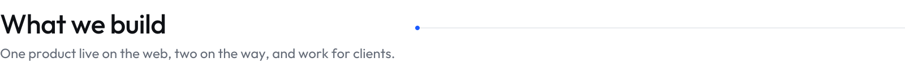
</picture>

<a href="https://amtsorakel.de"><picture><source media="(prefers-color-scheme: dark)" srcset="assets/tile-amtsorakel-dark.svg"></picture></a> <a href="https://hexese.com/lyra-voice/"><picture><source media="(prefers-color-scheme: dark)" srcset="assets/tile-lyra-dark.svg">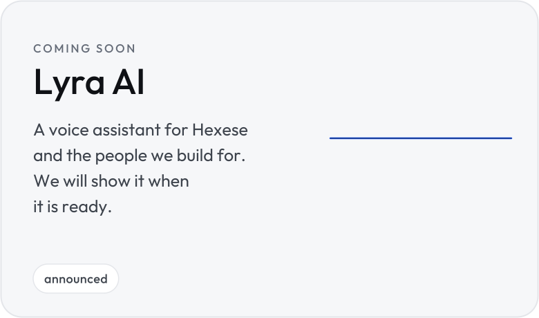</picture></a>
<a href="https://hexese.com/#app"><picture><source media="(prefers-color-scheme: dark)" srcset="assets/tile-app-dark.svg"></picture></a> <a href="mailto:info@hexese.com"><picture><source media="(prefers-color-scheme: dark)" srcset="assets/tile-clients-dark.svg">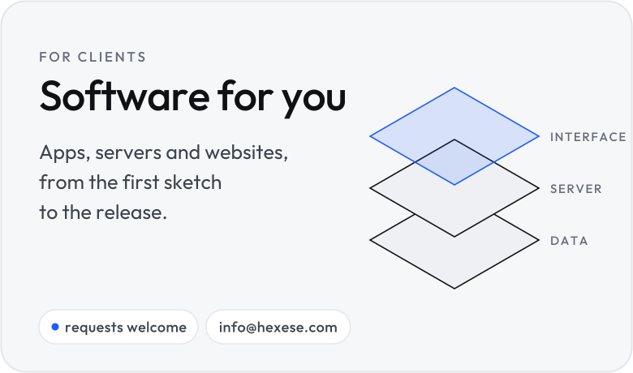</picture></a>

  

<picture>
  <source media="(prefers-color-scheme: dark)" srcset="assets/head-live-dark.svg">
  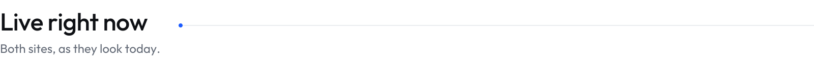
</picture>

<a href="https://amtsorakel.de"><picture><source media="(prefers-color-scheme: dark)" srcset="assets/shot-amtsorakel-dark.svg">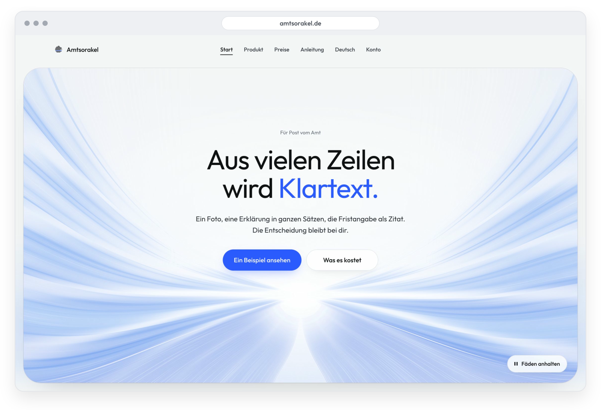</picture></a>
<a href="https://hexese.com"><picture><source media="(prefers-color-scheme: dark)" srcset="assets/shot-hexese-dark.svg">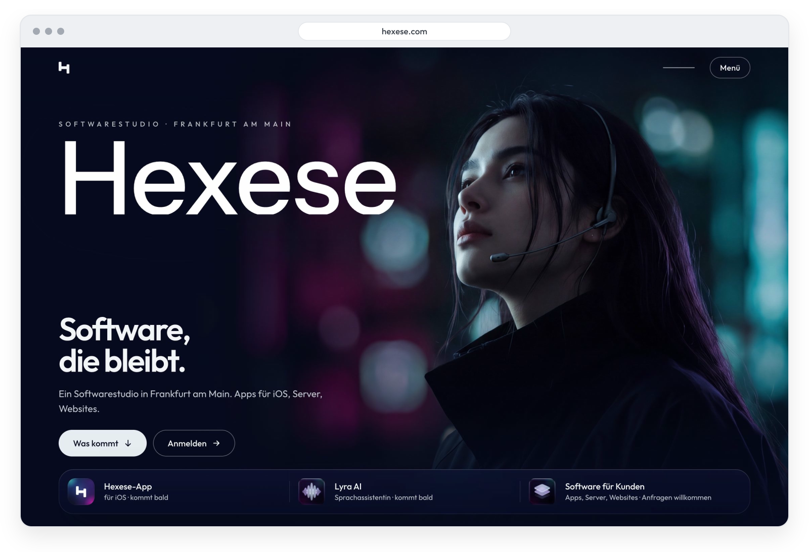</picture></a>

 

<picture>
  <source media="(prefers-color-scheme: dark)" srcset="assets/head-stack-dark.svg">
  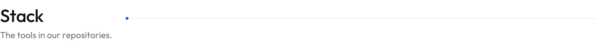
</picture>

<picture>
  <source media="(prefers-color-scheme: dark)" srcset="assets/stack-dark.svg">
  
</picture>

  

<picture>
  <source media="(prefers-color-scheme: dark)" srcset="assets/head-ship-dark.svg">
  
</picture>

<picture>
  <source media="(prefers-color-scheme: dark)" srcset="assets/ship-dark.svg">
  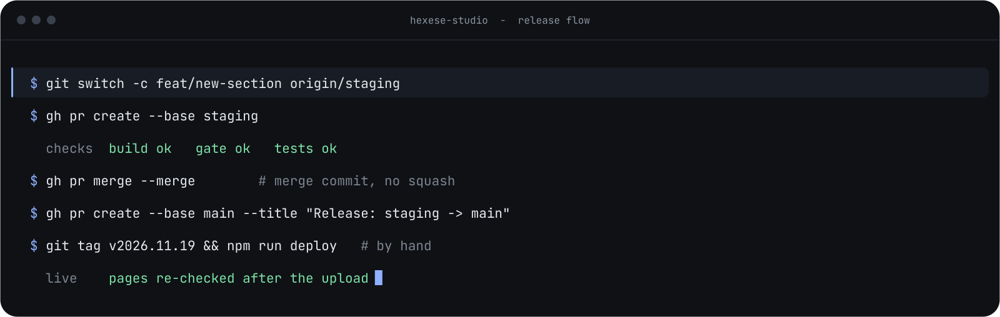
</picture>

- **Issue, branch, pull request.** Every change starts as an issue and lands in `staging` through a pull request with green checks.
- **`main` is what is live.** It only moves through a release pull request, and every upload gets a tag and a GitHub release.
- **A gate before every upload.** The build fails on third-party requests, inline style blocks, leftover markers and missing legal pages.
- **Deploys by hand.** Nothing goes live on a push.

 

<picture>
  <source media="(prefers-color-scheme: dark)" srcset="assets/head-find-dark.svg">
  
</picture>

<a href="https://hexese.com"><picture><source media="(prefers-color-scheme: dark)" srcset="assets/link-hexese-dark.svg"></picture></a> <a href="https://amtsorakel.de"><picture><source media="(prefers-color-scheme: dark)" srcset="assets/link-amtsorakel-dark.svg">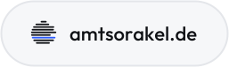</picture></a> <a href="mailto:info@hexese.com"><picture><source media="(prefers-color-scheme: dark)" srcset="assets/link-email-dark.svg"></picture></a> <a href="https://www.linkedin.com/company/hexese"><picture><source media="(prefers-color-scheme: dark)" srcset="assets/link-linkedin-dark.svg">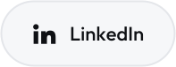</picture></a> <a href="https://www.instagram.com/hexese_studio"><picture><source media="(prefers-color-scheme: dark)" srcset="assets/link-instagram-dark.svg">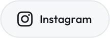</picture></a> <a href="https://x.com/hexese_studio"><picture><source media="(prefers-color-scheme: dark)" srcset="assets/link-x-dark.svg">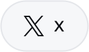</picture></a> <a href="https://www.youtube.com/@hexese"><picture><source media="(prefers-color-scheme: dark)" srcset="assets/link-youtube-dark.svg"></picture></a> <a href="https://www.tiktok.com/@hexese_studio"><picture><source media="(prefers-color-scheme: dark)" srcset="assets/link-tiktok-dark.svg">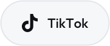</picture></a>

  

The product repositories are private. This repository holds the organisation profile and the default community files for every repository in the organisation.

<picture>
  <source media="(prefers-color-scheme: dark)" srcset="assets/footer-dark.svg">
  
</picture>
